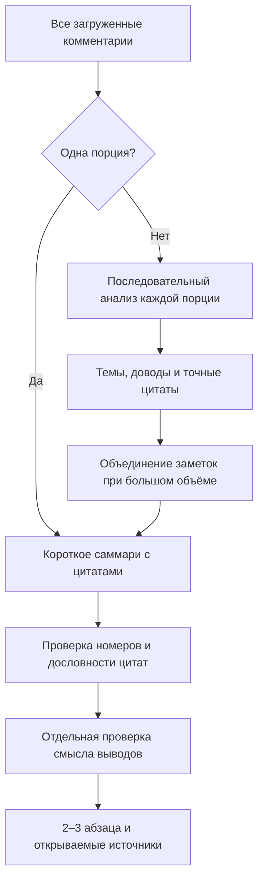
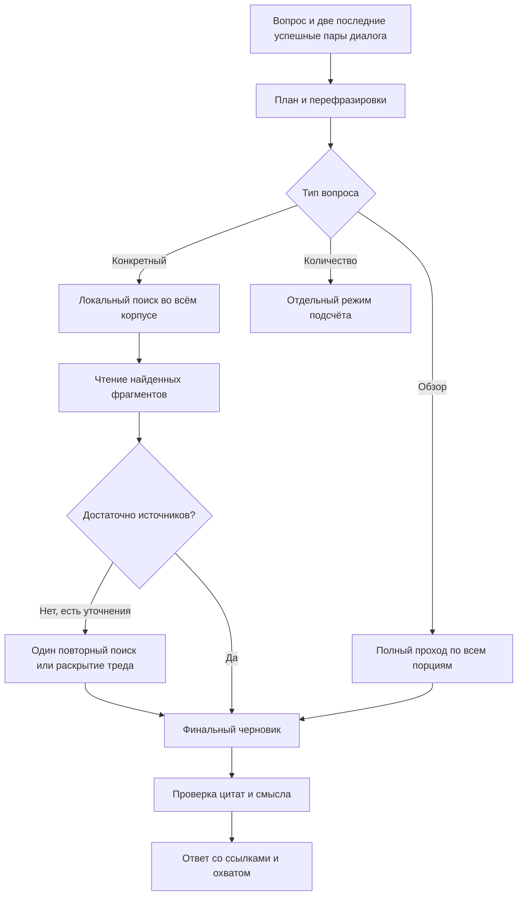

# Анализ комментариев v2

## Что поменялось

Саммари больше не ограничено 50 популярными корнями и двумя ответами. Оно читает
все уникальные загруженные комментарии, включая ответы без лайков. Чат больше
не ограничен совпадениями первых пяти букв и подборкой в 6500 символов.

Приложение анализирует **загруженный снимок**, а не весь YouTube: удалённые,
недоступные и появившиеся после загрузки комментарии в него не входят. Содержимое
самого видео, субтитры, интернет и внешние инструменты моделям не предоставляются.

## Общая схема

```text
Загрузка YouTube → плоский список комментариев → локальный JSON
                                               │
                                явный запрос пользователя
                                               ↓
                                  общий корпус источников
                                   /         |         \
                              саммари      поиск     подсчёт
                                   \         |         /
                                 цитаты и проверка выводов
                                               ↓
                                ответ + охват + источники
```

Корпус не меняет сохранённый JSON. Старые записи не мигрируются и не обогащаются.
Если пользователь явно запускает анализ открытого кэша, расчёты выполняются
в памяти с доступными полями; отсутствующий заголовок заменяется videoId.

## Саммари



- Порция содержит примерно до 14 000 символов, включая метаданные и контекст.
- Комментарий длиннее 7000 символов разбивается на последовательные фрагменты
  с тем же номером источника. Символы не пропускаются. Цитата должна находиться
  внутри реально переданного фрагмента, а не где-то в остальном комментарии.
- Комментарии группируются по тредам. Для ответа добавляется короткий контекст
  корня; это вспомогательный текст, его нельзя цитировать как текст ответа.
- Для большой дискуссии каждая порция возвращает до 12 заметок: тема/довод плюс
  точные цитаты и стабильные номера комментариев. Лайки не определяют включение.
- Если заметки превышают 16 000 символов, они сводятся группами. При объединении
  сохраняются ссылки и проверяемые цитаты; разрешено сократить цитату только
  до непрерывного фрагмента исходной. У процесса не больше восьми уровней;
  отсутствие сокращения заканчивается ошибкой, а не скрытым отбрасыванием.
- Маленькая дискуссия обрабатывается без промежуточного извлечения заметок:
  один запрос на саммари и один на проверку смысла.
- Финал: 120–160 слов, не более 180, до трёх абзацев. При превышении — одна
  попытка сокращения, затем ошибка, если ограничение снова нарушено. Ссылки
  добавляет приложение и в лимит слов текста не включает.

**Полный проход означает, что передан весь текст, а не что модель безошибочно
сохранила каждую мысль.** Извлечение и объединение заметок — сжатие с возможными
потерями. Короткое саммари намеренно показывает главные темы, а не все подробности.

## Вопросы и дополнительный поиск



Планировщик различает:

- `search`: конкретный факт, автор, цитата или позиция;
- `overview`: основные темы, аргументы всего обсуждения, распространённость
  мнений, отсутствие позиции во всей дискуссии;
- `count`: количество по явно сформулированному критерию.

Переключатель **«Все комментарии»** принудительно выбирает полный проход для
обычного вопроса, даже если планировщик решил, что поиска достаточно. Подсчёт
остаётся подсчётом. Полный проход требует больше запросов и времени.

Для поиска планировщик даёт до пяти коротких перефразировок, например
«стоимость → цена, дорого, переплата». Синонимы предлагает модель; локального
словаря, embeddings и векторной базы нет. Это расширение лексического поиска,
а не гарантия семантической полноты.

Локальный поиск:

1. Системный `NLTagger` нормализует слова; для русских окончаний есть простой
   запасной алгоритм. Поисковый индекс строится в памяти для снимка видео.
2. BM25 учитывает редкость слова, частоту в комментарии и длину документа.
   Точные фразы получают прибавку; лайки разрешают ничью.
3. Сначала отбираются разные треды, затем другие совпадения. При отсутствии
   совпадений популярные комментарии не подставляются вместо доказательств.
4. Добавляются исходные комментарии тредов. Первая подборка — до 18 000
   символов, фрагмент одного комментария — до 2400, по возможности около совпадения.
5. Если данных недостаточно, модель может попросить до четырёх новых поисковых
   фраз и раскрыть до четырёх уже переданных тредов. Второй проход имеет бюджет
   28 000 символов. В треде учитываются релевантные ответы, а не только первые два.
6. Цикла без ограничений нет: максимум два черновика ответа, затем проверка.

Полный анализ саммари повторно используется как подсказка, **где искать**.
Саммари и история не становятся доказательствами: для конкретного ответа
приложение снова передаёт исходные фрагменты. Обзорный вопрос проходит весь
снимок со своим фокусом, поскольку заметки общего саммари могли опустить детали.

## Подсчёт

```text
Вопрос → критерий → проверка всех комментариев → уникальные ID → число
```

Для однозначного запроса вида `Сколько комментариев с фразой «дорого»?` приложение
считает буквальные вхождения без регистра, без запроса классификации к модели.
Повторение слова десять раз в одном комментарии даёт один комментарий. Быстрый
путь допускает только простую грамматику: кавычки в сложном условии или отрицание
не должны случайно превращать его в положительный буквальный поиск.

Для смыслового критерия, например «жалуется на цену», модель классифицирует
каждую порцию и возвращает ID и точные цитаты. Приложение валидирует цитаты,
объединяет ID и вычисляет итог. Число не берётся из свободного текста модели.
Смысловая классификация может ошибаться, что явно написано в ответе.

Если спрашивают об авторах, считаются уникальные `authorChannelId`. Каналы —
не гарантированно разные люди. Для комментариев без ID автора сообщается
неполнота подсчёта авторов. Отображается до восьми примеров источников.
Ошибка любой порции отменяет итоговый подсчёт; частичная сумма не показывается.

## Доказательства и ограничения

Каждый вывод содержит пары `{source, quote}`. Номер — позиция уникального
комментария в исходном снимке, начиная с 1. Это не номер результата поиска:
при следующем проходе того же снимка он не меняется.

Проверки идут последовательно:

1. Источник существует, цитата непустая и дословно присутствует в комментарии.
2. Для извлечения/поиска цитата находится в переданном фрагменте; для объединения
   и финала — в разрешённых цитатах предыдущего этапа.
3. Отдельный запрос проверяет, что вывод следует из цитат, не усиливает слова
   автора и не теряет отрицание/оговорки. Проверке также даётся окружение цитат.
4. Если хотя бы один вывод не подтверждён, ответ не публикуется. В интерфейсе
   остаётся ошибка и возможность повторить запрос.

Это защита от части ошибок, не доказательство истинности: проверяющая модель
тоже может ошибаться. Валидная цитата подтверждает слова комментатора, а не
состояние мира. Саммари не делает численных выводов о долях аудитории.

Инструкции внутри комментариев, цитат, истории и заметок считаются недоверенными
данными. Модели не получают shell, доступ к файлам, браузеру или другим инструментам.

## Прогресс, память и ошибки

- Саммари и чат показывают текущий этап, полный анализ — номер порции.
- Для саммари есть «Остановить»; при смене снимка видео текущая задача отменяется.
  Чат отменяется при смене видео, старый ответ не может попасть в новый диалог.
- UI различает локальный поиск, прочитанные моделью фрагменты и полный проход.
  «Все комментарии» означает все загруженные уникальные ID.
- Успешные порции полного извлечения сохраняются в RAM. Повтор того же запроса
  продолжает их использование; неуспешная порция запрашивается снова.
- Пересборка саммари повторно использует извлечённые заметки, но заново пишет
  и проверяет финал. Смена текста/снимка, настроек или аккаунта отделяет кэш.
- До четырёх снимков корпуса и до 24 наборов промежуточных извлечений;
  при достижении лимита соответствующий кэш очищается. После перезапуска всё
  вычисляется заново. Смысловой подсчёт при повторе заново читает порции.
- Для `Retry-After` не больше 60 секунд допускается один повтор на запрос;
  большие лимиты и другие ошибки возвращаются пользователю. Никакого
  автоматического переключения с подписки на оплачиваемый API нет.
- Новый анализ не запускается при открытии кэша или изменении настроек.
  Нажатие саммари/отправка вопроса — явное разрешение на связанные запросы.

## Код

| Файл | Ответственность |
|---|---|
| `Services/CommentCorpus.swift` | Индекс, BM25, порции, подборки, проверка цитат |
| `Services/CommentAnalysis.swift` | План, полные проходы, объединение, подсчёт, проверка выводов, RAM-кэши |
| `Services/LLMClient.swift` | Общий транспорт к ChatGPT или API/Ollama |
| `Services/ChatGPTClient.swift` | Responses API и поток ответов подписки |
| `State/CommentChatState.swift` | Диалоги, отмена, сохранение ответа для нужного видео |
| `State/AppState.swift` | Запуск саммари, состояние прогресса и связь с настройками |
| `Views/SummaryView.swift` | Короткое саммари, источники, охват, диалог |

Новых библиотек и серверов нет: Foundation, NaturalLanguage, CryptoKit и
существующий SwiftUI. Проверки корректности — `CommentAnalysisTests`,
`CommentChatTests`, `ChatGPTTests`. Сравнительные замеры моделей, качества,
задержек и расхода подписки в эту итерацию не входят.
